# compliance-case-agents

A proof of concept for AI agents that help analysts fill in compliance questionnaires (.NET 8, Azure). A compliance case is a long questionnaire with supporting documents, and many questions apply only when an earlier answer has a certain value. Agents read the documents and propose an answer for each question with the evidence for it (a quote, the document and the page). They flag what is missing. Analysts review, correct and can take over a case at any moment. Only a person writes a final value, and every value keeps who set it, when, on what basis and with which model and prompt version.

## Status

Work in progress. Built as preparation for a case-study interview. Runs locally (in-memory storage, fake models). Not production code. All data is made up.

## The scenario

Question Q4 is "Does the client hold accounts outside the EU?". Q4.1 to Q4.3 (countries, balance, tax declaration) apply only if Q4 = Yes.

1. A submitter marks the case ready. This publishes a `case.ready` event.
2. The AI backend proposes Q4 = **Yes**, quoting "The account held with Example Bank (Zurich) was closed on 14 March 2024." from the bank letter, page 3. Confidence is High, the verifier passes, the prompt version is v12. It also proposes Q4.1 to Q4.3, marked "depends on Q4, not confirmed yet". This is a plausible mistake: the line mentions the account, and the account is closed.
3. Analyst A. Silva reads the letter, sees the account was closed in 2024, and sets Q4 to **No** with the reason "Account closed in 2024, per bank letter, p. 3".
4. The `answer.confirmed` event goes back to the AI backend. The parent is No, so Q4.1 to Q4.3 become **Withdrawn**, with a reason. Nothing is deleted. Had the analyst confirmed Yes, they would have become normal proposals that still need a person.
5. The audit view shows both steps: proposed Yes by the Answerer agent (prompt v12, bank letter p. 3, High, verifier passed), final No by A. Silva at 17 Nov 10:42, effect "Q4.1 to Q4.3 proposals withdrawn".

The point of the scenario: the agent and the verifier were both wrong, so verification does not replace the analyst.

## Architecture

### 1. Overview

The case application owns the case, the questionnaire and the final answers. The AI backend owns proposals, evidence and confidence. They meet only at the Case API (HTTP) and the event bus. In this PoC both run in one .NET process, because the in-memory bus cannot cross processes, but the AI backend never touches the case store directly.

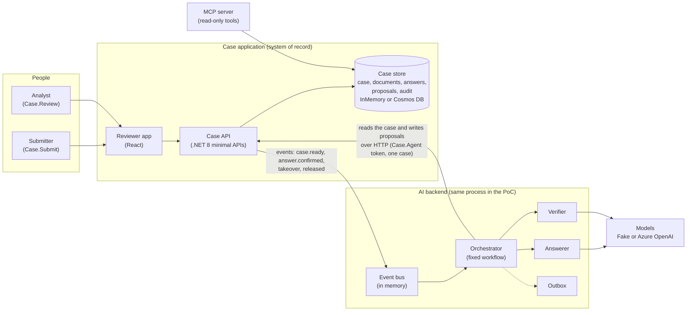

### 2. The Q4 scenario

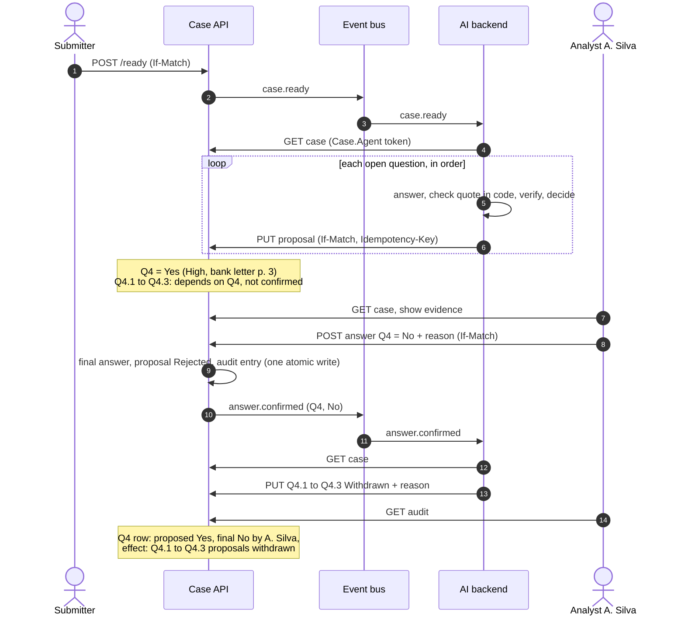

### 3. Data model

One container, items distinguished by `type`, partition key `/caseId`. Every write replaces the `case` item, so the case `_etag` is the version of the whole case.

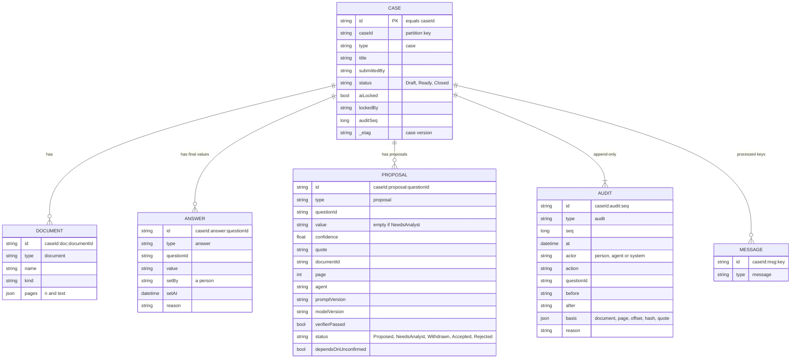

## Run locally

Prerequisites: .NET 8 SDK and Node 20.19+ or 22 LTS. Docker is needed only for Cosmos mode. The defaults are InMemory storage and the Fake models, so nothing else is required.

```powershell
./scripts/dev.ps1 -Seed          # Windows
```
```bash
./scripts/dev.sh --seed          # Linux / macOS
```

| Flag (PowerShell / bash) | Effect |
|---|---|
| `-Seed` / `--seed` | Waits for the API, then creates the demo cases (`scripts/seed.mjs`), waits for the proposals and plays the analysts' decisions |
| `-Shadow` / `--shadow` | `AiBackend__ShadowMode=true`: proposals are recorded for evaluation but never shown to analysts. Do not combine with the seed |
| `-Cosmos` / `--cosmos` | Cosmos mode: `docker compose up -d`, then API and MCP against the emulator. Needs `CASEAGENTS_COSMOS_CONNECTION_STRING` in your environment |

| Component | URL |
|---|---|
| Reviewer app | http://localhost:5173 |
| Case API (with the AI backend) | http://localhost:5080 |
| MCP server | http://localhost:5090/mcp (Cosmos mode only) |

Log in with a dev token: **A. Silva** as Reviewer (the analyst), **alice** as Submitter. Dev tokens (`POST /dev/token`) exist only in the Development environment.

The seed creates seven cases: the live-demo case (left with proposals for you to decide), a completed example (A. Silva already corrected Q4 at 17 Nov 10:42 using the dev clock), a case with a hidden instruction in a payslip (identity document, proof of address, bank letter and the payslip, but no client declaration, so Q3 and Q6 stay "Needs analyst" with no value), and four historical cases decided by B. Costa so that the Eval has data.

### Cosmos mode

```powershell
$env:CASEAGENTS_COSMOS_CONNECTION_STRING = "<emulator connection string>"
./scripts/dev.ps1 -Cosmos -Seed
```

`Storage:Mode=Cosmos` with `Storage:Cosmos:ConnectionString` and `EmulatorMode=true` targets the Linux emulator started by `docker-compose.yml`. With `Storage:Cosmos:AccountEndpoint` it targets a real account through `DefaultAzureCredential`. If port 8081 is taken, set `COSMOS_EMULATOR_PORT` (for example `18081`) and use the same port in the connection string.

### Azure OpenAI mode

By default the Answerer and Verifier are fakes: deterministic keyword matching, so the demo and the tests always behave the same (Q4 is always Yes with 0.93). To use real deployments:

```bash
Models__Mode=AzureOpenAI
AzureOpenAI__Endpoint=https://<account>.openai.azure.com
AzureOpenAI__Deployment=<chat deployment that returns logprobs>
AzureOpenAI__VerifierDeployment=<optional second deployment>
```

Authentication uses `DefaultAzureCredential`; there are no keys. The app checks each deployment at startup and stops with a clear message if one cannot be used.

## Roles

| Role | Who | Can |
|---|---|---|
| `Case.Submit` | Submitters | Create cases, attach documents, mark ready, read their own cases |
| `Case.Review` | Analysts | Read all cases, accept, edit or reject proposals (write final values), take over, release, read the audit, read evaluation records |
| `Case.Agent` | The AI backend's identity | Read ONLY the one case in its token (`case_id` claim) and write ONLY proposals. A final value write gets 403, another case gets 404 |

## HTTP API

JSON in camelCase, enum names as strings, nulls omitted. Writes to a case carry `If-Match` with the case version (`_etag`); 409 means the case changed: re-read and decide again.

| Method and path | Access | Result |
|---|---|---|
| `POST /dev/token` | Dev only | Dev token (an agent token needs `caseId`) |
| `GET`/`POST /dev/faults` | Dev only | Simulate "AI backend down" and "case app down" |
| `POST /dev/clock` | Dev only | Set the app clock (used by the seed) |
| `GET /api/questionnaire` | Any role | The questionnaire |
| `GET /api/cases` | Submit (own), Review (all) | Case summaries, newest first |
| `POST /api/cases` | Submit | Create a draft case |
| `POST /api/cases/{id}/documents` | Submit, own case, `If-Match` | Attach a document (text per page) |
| `POST /api/cases/{id}/ready` | Submit, own case, `If-Match` | Mark ready, publish `case.ready` |
| `GET /api/cases/{id}` | Any role that can read the case | Case view; `ETag` header; shadow proposals only for agents |
| `PUT /api/cases/{id}/proposals/{qid}` | Agent for this case, `If-Match`, `Idempotency-Key` | Write a proposal |
| `POST /api/cases/{id}/answers/{qid}` | Review, `If-Match` | `accept`, `edit` (value and reason) or `reject` (reason) |
| `POST /api/cases/{id}/takeover` | Review, `If-Match` | Lock the AI out and bump the version |
| `POST /api/cases/{id}/release` | Review, `If-Match` | Unlock; the backend continues |
| `GET /api/cases/{id}/audit` | Review | Audit view and raw entries |
| `GET /api/eval/records` | Review | Cases with proposals, including shadow ones |
| `GET /api/ops/status` | Review | Bus counters, dead letters, outbox size, faults |

409 bodies carry a `code`: `version_changed`, `ai_locked`, `final_answer_exists`, `touched`, `not_applicable`, `case_not_ready` or `conflict`. There is no update or delete route for the audit trail, and a test checks it.

## PoC simplification vs the design

| Design | In this PoC |
|---|---|
| Document Intelligence reads PDFs and scans | Documents are text per page, already extracted |
| Service Bus with sessions per case and a dead-letter queue | In-memory bus with a per-case sequence, message ids, retries and a dead-letter list |
| Durable Functions orchestrator | In-process orchestrator; its state is the case store (proposals and audit) plus an in-memory outbox |
| Power Apps and Dataverse case application | Case API and a React reviewer app |
| Azure OpenAI | Optional (`Models:Mode=AzureOpenAI`); Fake models by default |
| AI Search with a per-case index | Per-case in-memory index of the document pages |
| Audit copied to immutable storage | Not implemented; the store is append-only, nothing more |
| Prompt Shields scan the text sent to the model | Not called; untrusted-data labelling, fixed schema and the verifier only |
| Per-case agent tokens from a managed identity, enforced by the orchestrator and APIM | Dev tokens with a `case_id` claim |

## Tests

```bash
dotnet build CaseAgents.sln
dotnet test
```

Tests cover the business rules (question order and dependencies, quote verification, proposal policy, gaps, audit view), storage (atomic writes, ETags, idempotency), the bus (order, duplicates, retries, dead letters), the API (roles, take over against an in-flight write, idempotency, append-only audit, the full Q4 scenario, the seeded payslip case with its hidden instruction), the MCP tools and the Eval. `npm test` in `web/` covers the display rules of the reviewer app (not-applicable text, the "depends on" flag, the audit cell, UTC times, quote highlighting).

Cosmos integration tests are skipped unless enabled:

```bash
docker compose up -d
# set CASEAGENTS_COSMOS_TESTS=1 (bash: export; PowerShell: $env:CASEAGENTS_COSMOS_TESTS="1")
dotnet test --filter "Category=CosmosIntegration"
```

The tests read `CASEAGENTS_COSMOS_CONNECTION_STRING` and `COSMOS_EMULATOR_PORT` as the dev scripts do.

Web, seed script and infrastructure:

```bash
cd web && npm ci && npm run typecheck && npm test && npm run build && npm run lint
node --check scripts/seed.mjs
az bicep build --file infra/main.bicep --stdout
```

## Evaluation

The Eval console compares the agents' proposals with the analysts' final values. For each question type (`yes_no`, `free_text`, and all) it prints the precision of the proposals and the rate of proposals accepted unchanged. The second number is a risk signal for over-trust, not a success measure. Shadow proposals count for precision only.

```bash
# Local (reads through the API; start the app first)
dotnet run --project src/CaseAgents.Eval -- --api http://localhost:5080

# Cosmos emulator (reads the container)
Storage__Mode=Cosmos Storage__Cosmos__ConnectionString="<emulator connection string>" Storage__Cosmos__EmulatorMode=true \
  dotnet run --project src/CaseAgents.Eval
```

These examples use bash syntax. In PowerShell, set each variable first (for example `$env:Storage__Mode = "Cosmos"`), then run `dotnet run --project src/CaseAgents.Eval`.

## MCP server

`src/CaseAgents.Mcp` exposes two read-only tools at `/mcp`: `get_case(caseId)` and `get_open_proposals(caseId)`. It uses the same read rule as the API, shows no shadow proposals, and cannot write (it depends only on the read interface). It needs shared storage, so it runs in Cosmos mode (`-Cosmos`). See [ADR 0005](docs/adr/0005-read-only-mcp.md).

## Configuration

No keys anywhere. Azure calls use `DefaultAzureCredential`; local secrets go in `dotnet user-secrets` or environment variables (`Section__Key` form).

| Key | Meaning |
|---|---|
| `Storage:Mode` | `InMemory` (default) or `Cosmos` |
| `Storage:Cosmos:*` | `AccountEndpoint`, `ConnectionString` (emulator only), `DatabaseName`, `ContainerName`, `EnsureCreated`, `EmulatorMode` |
| `Models:Mode` | `Fake` (default) or `AzureOpenAI` |
| `AzureOpenAI:Endpoint` / `Deployment` / `VerifierDeployment` / `ApiVersion` | Azure OpenAI account, answerer deployment (must return logprobs), optional verifier deployment, API version |
| `AiBackend:Enabled` | `false` turns the in-process AI backend off (analysts keep working) |
| `AiBackend:ShadowMode` | `true` records proposals that analysts never see |
| `AiBackend:CaseApiBaseUrl` | Where the AI backend reaches the Case API (default `http://localhost:5080`) |
| `AiBackend:AgentUserId` | User id in the AI backend's agent tokens and audit entries (default `ai-backend`) |
| `AiBackend:MaxConflictRetries` | Consecutive 409s before a run gives up (default 5) |
| `AiBackend:OutboxFlushInterval` | How often the outbox is retried (default `00:00:02`) |
| `Bus:*` | `MaxDeliveryCount` (default 3), `RetryDelay` (first retry delay, doubled each time; default `00:00:01`), `OutOfOrderTimeout` (default `00:00:30`), `PumpInterval` (default `00:00:00.200`) |
| `Auth:Mode` | `Entra` (default) or `Dev` (Development environment only; the AI backend runs only in Dev mode) |
| `Auth:Dev:SigningKey` | Dev token signing key (32+ characters; the dev scripts generate one per run) |
| `AzureAd:*` | Entra settings (`Instance`, `TenantId`, `ClientId`, `Audience`) |
| `Questionnaire:Path` | Path of `questionnaire.json` (defaults to the copy next to the executable) |

The questionnaire, required documents, thresholds and prompt version live in [config/questionnaire.json](config/questionnaire.json).

## Demo

Script: [docs/DEMO.md](docs/DEMO.md). The screenshots in `docs/img/` follow the scenario in order:

| File | Shows |
|---|---|
| `demo-01-login.png` | Login |
| `demo-02-case-list.png` | Case list |
| `demo-03-q4-proposal.png` | Q4 proposal: Yes, High, verifier passed, Q4.1 to Q4.3 depend on Q4 |
| `demo-04-evidence.png` | Evidence viewer on the bank letter, page 3, quote highlighted |
| `demo-05-edit-q4.png` | Analyst edits Q4 to No with a reason |
| `demo-06-withdrawn.png` | Q4.1 to Q4.3 withdrawn |
| `demo-07-audit.png` | Audit tab, row Q4 |
| `demo-08-takeover.png` | Case taken over |
| `demo-09-ai-pending.png` | "AI pending" banner with the AI backend down |

| | | |
|---|---|---|
| 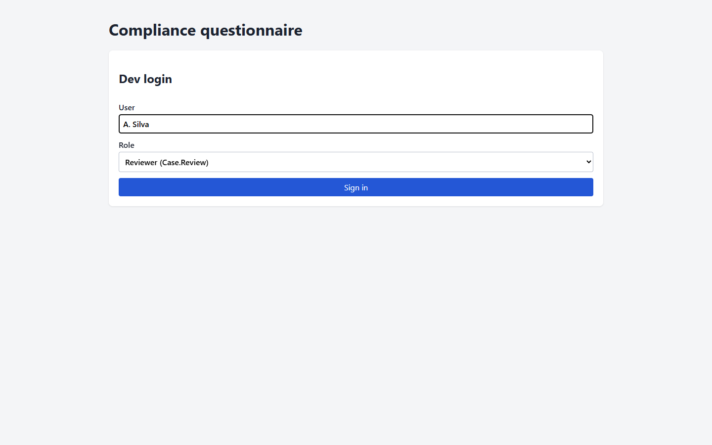 | 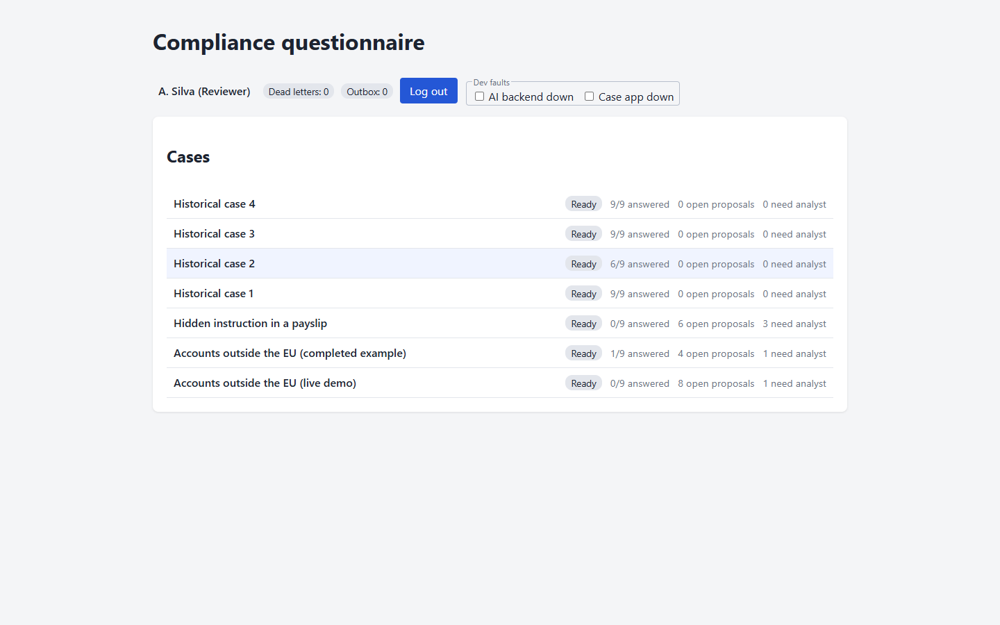 | 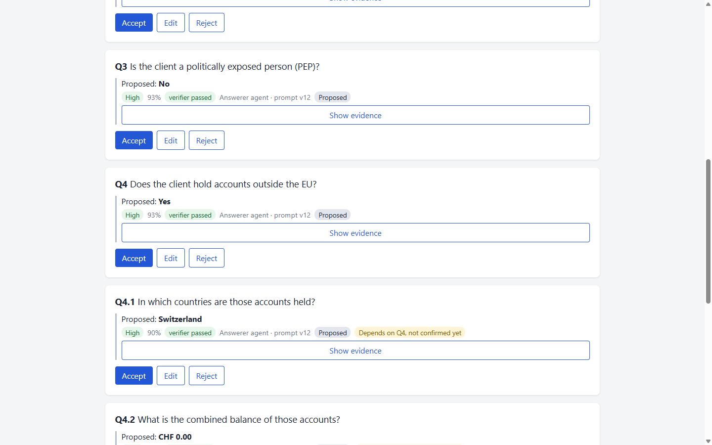 |
| 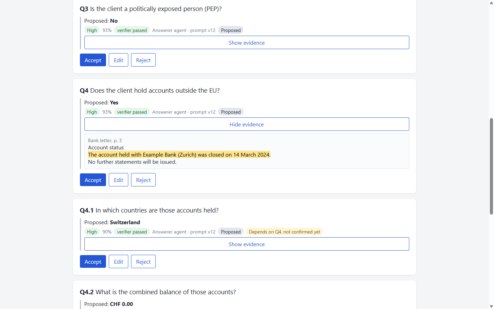 | 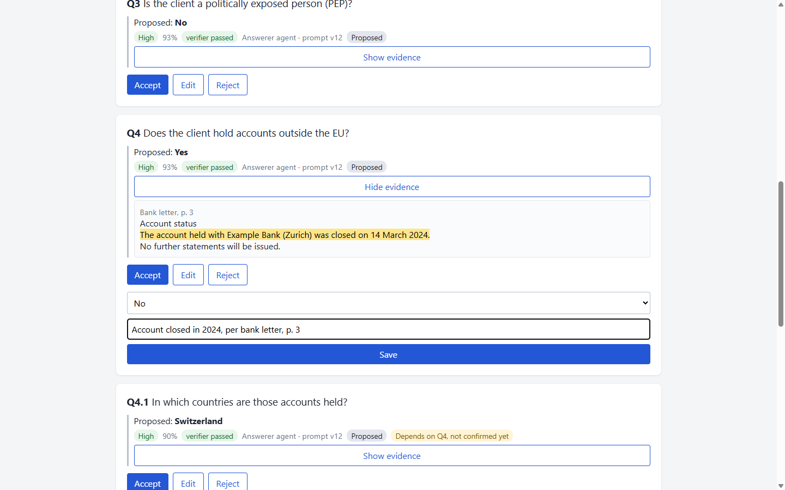 | 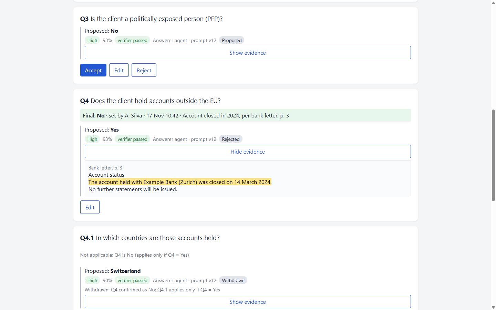 |
| 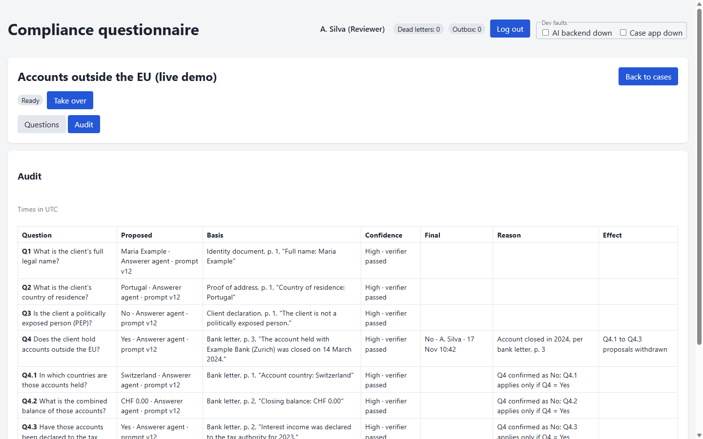 | 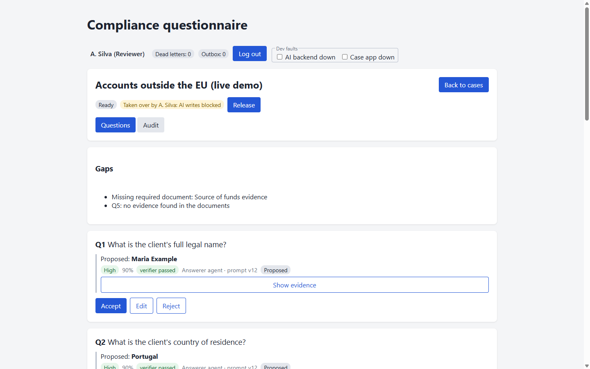 | 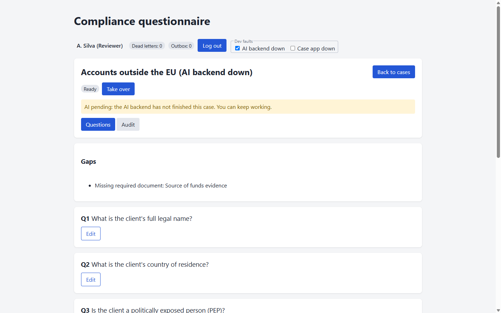 |

## Repository layout

| Path | Content |
|---|---|
| `src/CaseAgents.Core` | Models, contracts and business rules (no I/O) |
| `src/CaseAgents.Infra` | Storage (InMemory, Cosmos), event bus, auth setup |
| `src/CaseAgents.Agents` | The AI backend: models (Fake, Azure OpenAI), orchestrator, case API client, outbox |
| `src/CaseAgents.Api` | Case API host (and the AI backend in the same process) |
| `src/CaseAgents.Mcp` | Read-only MCP server |
| `src/CaseAgents.Eval` | Evaluation console |
| `web` | Reviewer app (React, TypeScript, Vite) |
| `config` | `questionnaire.json`, `scenario-documents.json` |
| `scripts` | Dev scripts and the seed |
| `tests` | xUnit tests |
| `infra` | Bicep and the APIM policy (reference only, not deployed) |
| `docs` | Demo script, adapting guide, decisions and ADRs |

## Decisions and trade-offs

- Fixed workflow versus agent autonomy: the code picks the next question, the models only answer. Predictable and auditable, less flexible (ADR 0001).
- Events over direct calls: each side can be down without blocking the other. Cost is some delay and a queue to run (ADR 0004).
- Proposals separate from final values: a person is the only writer of a final value. Cost is two sets of items and an event back to the backend (ADR 0006).
- Second-model verifier: catches quotes that do not support the answer, but costs another call per question, and the two models can be wrong in the same way, as the Q4 scenario shows. The analyst stays.
- One service for four roles (Extractor, Answerer, Verifier, Gap finder): simpler to run now, split later only if needed.
- Masking personal data before it reaches the model: less exposure, but it can reduce accuracy, so measure it per question type.

## Production mapping

| In this PoC | In production |
|---|---|
| In-memory event bus | Azure Service Bus, sessions keyed by `caseId`, dead-letter queue with an alert ([ADR 0007](docs/adr/0007-service-bus-vs-api-only.md)) |
| Custom in-process orchestrator | Durable Functions; `WaitForExternalEvent` waits for analyst decisions and new documents between rounds ([ADR 0009](docs/adr/0009-case-rounds-and-partial-documents.md)) |
| In-memory outbox | Durable orchestration state |
| `dependsOn` in `config/questionnaire.json`, loaded at start-up | The same rules as versioned data, enforced server-side in the case application, each case pinned to a version ([ADR 0008](docs/adr/0008-question-dependencies-as-versioned-data.md)) |

Built in .NET because it is my fastest stack for a PoC. The design maps 1:1 to Python: FastAPI for the APIs, Durable Functions for Python for the orchestration, Agent Framework for Python for the model calls.

## What I'd do in production

- Service Bus with sessions per case id and dead-letter queue alerts, instead of the in-memory bus.
- Durable Functions for the orchestration state, instead of the in-process orchestrator and memory outbox.
- Document Intelligence for PDFs and scans, instead of text already extracted.
- AI Search with a per-case index and security trimming, instead of the in-memory index.
- Prompt Shields on every text sent to a model.
- Private endpoints, EU data zone, public access off for Azure OpenAI and Cosmos.
- Immutable copy of the audit trail plus a reconciliation job that checks no value changed without an event.
- Crypto-shredding for erasure requests, so the audit keeps references and hashes only.
- An evaluation gate built from analyst corrections, before any prompt or model change goes live.
- A second Azure OpenAI deployment in the EU as failover behind API Management.

## More documentation

- [docs/DEMO.md](docs/DEMO.md): the 5 to 6 minute demo script.
- [docs/ADAPTING.md](docs/ADAPTING.md): what changes for a real questionnaire.
- [docs/DECISIONS.md](docs/DECISIONS.md): key decisions and the assumptions behind them.
- [docs/adr](docs/adr): short architecture decision records.
- [infra/README.md](infra/README.md): Azure resources.

## License

MIT. See [LICENSE](LICENSE).
